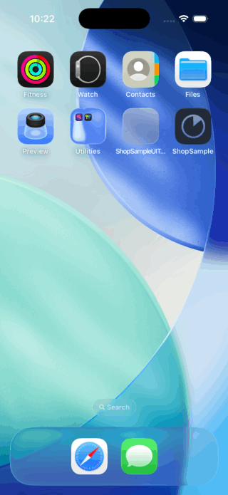

# Run iOS UI tests against a Mockphine mock in GitHub Actions

[](https://github.com/MockphineApp/mockphine-ios-ci-example/actions/workflows/ui-tests.yml)

This repository is a working example. A small iOS app has three UI tests, and a GitHub Actions workflow runs them on an iOS simulator against a mock API that [Mockphine](https://mockphine.com) serves from a file in the repository. No real backend is involved.



The recording comes from a run of this workflow on GitHub's runner, cut down to the three tests. The app prints the API address it calls and the scenario the test asked for, so you can follow each test:

| Test | The app sends | The mock answers | The app shows |
| --- | --- | --- | --- |
| `testCheckoutShowsADeclinedCard` | `POST /orders` with `x-mock-state: declined` | 402 | Payment declined |
| `testCheckoutSucceeds` | `POST /orders` | 201 | Order placed |
| `testProductsComeFromTheMock` | `GET /products` | 200 with one product | Espresso cup |

The same clip as a video is [docs/ui-tests.mp4](docs/ui-tests.mp4).

On 2026-11-21 both jobs passed on GitHub's `macos-26` runner with Xcode 26.6 and an iPhone 17 simulator on iOS 26.5. A job takes eight to nine minutes.

## How it works

1. The workflow checks out the repository, which holds the mock as `mocks/Shop.mockphine`.
2. It generates the Xcode project. One job uses XcodeGen and one uses Tuist; pick the one your team uses.
3. `scripts/run-ui-tests.sh` starts the mock with the Mockphine CLI and waits until it is running.
4. The script builds the app, then runs the UI tests on a simulator. The tests pass the mock's address to the app.
5. The script saves the mock's Request Log, stops the mock, and exits with the tests' status.
6. The workflow shows the Request Log in the job summary and uploads it with the logs and a recording of the simulator.

Mockphine serves the data. Your UI tests decide whether the job passes.

## What is in this repository

```text
App/ShopApp.swift               the sample app: a product list and a Buy button
UITests/ShopUITests.swift       three XCUITest cases
mocks/Shop.mockphine            the mock: one server, four endpoints, one error case
scripts/run-ui-tests.sh         start the mock, run the tests, stop the mock
scripts/pick-simulator.py       picks an iPhone simulator on the newest iOS runtime
project.yml                     the project for XcodeGen
Project.swift, Tuist.swift      the same project for Tuist
mise.toml                       pins the Tuist version
.github/workflows/ui-tests.yml  the workflow
tools/                          a preview build of the Mockphine CLI (see the last section)
```

## Before you start

- **A Mac runner.** The Mockphine CLI runs on macOS 26 or later on Apple silicon. This example uses GitHub's `macos-26` runner.
- **The Mockphine CLI.** It ships inside the app at `/Applications/Mockphine.app/Contents/Helpers/mockphine`. This example uses a preview build from `tools/`; see [About the CLI in this repository](#about-the-cli-in-this-repository).
- **An app that can change its API address.** Step 2 shows the few lines this takes.

## Step 1: Build the mock and commit it

Build the mock in Mockphine as you normally do: create a server, add endpoints or import an OpenAPI file, and give each endpoint the response you want. Then prepare it for CI:

1. **Fix the port.** In the server's Overview, set Bind Address to `127.0.0.1` and choose a port that your CI machine leaves free. This example uses 47861.
2. **Add the error scenarios your tests need.** Open the endpoint, add a response case in Response Flow, and give it a header condition. In this example `POST /orders` has a case named Card declined: it answers 402 when the request carries the header `x-mock-state: declined`. Any other request to that endpoint gets the default 201.
3. **Save the document inside your app's repository.** This example keeps it at `mocks/Shop.mockphine`.
4. **Look up the server's ID.** The CLI commands take it:

   ```sh
   mockphine workspace inspect mocks/Shop.mockphine
   ```

   ```text
   Shop
   ec372f8c-2148-4b98-8623-3e6d4b09101a	127.0.0.1:47861	Shop API
   ```

The CLI can also add the error case. This is the command that created the one in this repository:

```sh
mockphine response-case create \
  --workspace mocks/Shop.mockphine \
  --server-id ec372f8c-2148-4b98-8623-3e6d4b09101a \
  --endpoint-id <id of POST /orders> \
  --name "Card declined" \
  --conditions declined.json \
  --status-code 402 \
  --response-header 'Content-Type:application/json' \
  --body '{"error":"card_declined"}'
```

`declined.json` holds the condition:

```json
{
  "body": [],
  "headers": [
    {
      "id": "6F1C1B3A-0000-4000-8000-0000000000A1",
      "name": "x-mock-state",
      "operation": "exact",
      "expectedValue": "declined"
    }
  ],
  "query": { "exactValue": "", "mode": "none", "pairs": [] }
}
```

## Step 2: Let the app read its API address

The app takes its base URL from the environment and falls back to the real backend. In your own app, wrap this in `#if DEBUG` so a release build ignores it.

```swift
let environment = ProcessInfo.processInfo.environment
baseURL = URL(string: environment["API_BASE_URL"] ?? "https://api.shop.example.test")!
mockState = environment["MOCK_STATE"]
```

When a test asks for a scenario, the app forwards it as a request header:

```swift
if let mockState {
  request.setValue(mockState, forHTTPHeaderField: "x-mock-state")
}
```

An iOS simulator shares the Mac's network, so `http://127.0.0.1:47861` inside the simulator reaches the mock on the runner. The mock serves plain HTTP. The sample's Info.plist sets `NSAllowsLocalNetworking` under `NSAppTransportSecurity`; both `project.yml` and `Project.swift` add it.

## Step 3: Write UI tests that choose a scenario

A test hands the mock's address to the app through the launch environment. To test an error, it also names the scenario:

```swift
@MainActor
private func launch(mockState: String? = nil) -> XCUIApplication {
  let app = XCUIApplication()
  app.launchEnvironment["API_BASE_URL"] =
    ProcessInfo.processInfo.environment["MOCK_BASE_URL"] ?? "http://127.0.0.1:47851"
  if let mockState {
    app.launchEnvironment["MOCK_STATE"] = mockState
  }
  app.launch()
  return app
}

@MainActor
func testCheckoutShowsADeclinedCard() {
  let app = launch(mockState: "declined")
  waitForStatus("Ready", in: app)
  app.buttons["buy"].tap()
  waitForStatus("Payment declined", in: app)
}
```

`MOCK_BASE_URL` comes from the script in the next step. `xcodebuild` passes any variable named `TEST_RUNNER_<NAME>` to the test runner as `<NAME>`, so the script sets `TEST_RUNNER_MOCK_BASE_URL`.

Each test picks its own answer through a header on its own requests. No test changes the mock, so one test cannot break another.

## Step 4: The script

[scripts/run-ui-tests.sh](scripts/run-ui-tests.sh) is the whole integration. Its core:

```sh
MOCKPHINE="${MOCKPHINE:-/Applications/Mockphine.app/Contents/Helpers/mockphine}"
WORKSPACE="mocks/Shop.mockphine"
SERVER_ID="ec372f8c-2148-4b98-8623-3e6d4b09101a"
BASE_URL="http://127.0.0.1:47861"
export DO_NOT_TRACK=1

# Start the mock in the background and wait until it is running.
"$MOCKPHINE" server start --workspace "$WORKSPACE" --server-id "$SERVER_ID" > build/mock.log 2>&1 &
until "$MOCKPHINE" server status --workspace "$WORKSPACE" --server-id "$SERVER_ID" | grep -q '^running'; do
  sleep 0.2
done

# Build, then test. The test runner receives MOCK_BASE_URL.
xcodebuild build-for-testing -project ShopSample.xcodeproj -scheme ShopSample \
  -destination "id=$DEVICE_ID" -derivedDataPath build/DerivedData
TEST_RUNNER_MOCK_BASE_URL="$BASE_URL" xcodebuild test-without-building \
  -project ShopSample.xcodeproj -scheme ShopSample \
  -destination "id=$DEVICE_ID" -parallel-testing-enabled NO \
  -derivedDataPath build/DerivedData -resultBundlePath build/UITests.xcresult
STATUS=$?

# Save what the mock answered, stop it, and report the tests' status.
"$MOCKPHINE" logs list --workspace "$WORKSPACE" --server-id "$SERVER_ID" > build/mock-requests.txt
"$MOCKPHINE" server stop --workspace "$WORKSPACE" --server-id "$SERVER_ID"
exit "$STATUS"
```

Four details matter:

- **The script waits on `server status`.** Polling the status sends no request to the mock, so the Request Log holds your app's calls and nothing else.
- **It builds before it tests.** A build failure and a test failure then show up as different steps in the log, and the recording covers the tests only.
- **It always stops the mock** and returns the tests' status, so the job fails when a test fails.
- **`DO_NOT_TRACK=1`** turns the CLI's analytics off for the job.

To use the script in your project, change `WORKSPACE`, `SERVER_ID`, `BASE_URL`, and the project and scheme names.

## Step 5: The workflow

[.github/workflows/ui-tests.yml](.github/workflows/ui-tests.yml) runs the script on `macos-26`, once with a project from XcodeGen and once with a project from Tuist:

```yaml
jobs:
  ui-tests:
    name: UI tests (${{ matrix.generator }})
    runs-on: macos-26
    strategy:
      fail-fast: false
      matrix:
        generator: [xcodegen, tuist]
    steps:
      - uses: actions/checkout@v7

      - name: Install the Mockphine CLI
        run: |
          unzip -q tools/mockphine-cli-macos-arm64.zip -d "$RUNNER_TEMP/mockphine"
          echo "MOCKPHINE=$RUNNER_TEMP/mockphine/mockphine" >> "$GITHUB_ENV"

      - name: Generate the project with XcodeGen
        if: matrix.generator == 'xcodegen'
        run: |
          command -v xcodegen > /dev/null || brew install xcodegen
          xcodegen generate

      - name: Install Tuist
        if: matrix.generator == 'tuist'
        uses: jdx/mise-action@v5

      - name: Generate the project with Tuist
        if: matrix.generator == 'tuist'
        run: tuist generate --no-open

      - name: Run UI tests against the mock
        env:
          RECORD_VIDEO: "1"
        run: scripts/run-ui-tests.sh
```

Two more steps run even when a test fails: one writes the Request Log into the job summary, and one uploads the Request Log, the logs, and the simulator recording as an artifact.

Your project needs one of the two generate steps, or neither if you commit the Xcode project.

## Run it on your Mac

With Mockphine installed in `/Applications`:

```sh
xcodegen generate            # or: tuist generate --no-open
scripts/run-ui-tests.sh
```

Add `RECORD_VIDEO=1` to record the simulator to `build/ui-tests.mp4`, and `DEVICE_ID=<simulator id>` to choose the simulator.

## What a run gives you

- **Pass or fail** from your UI tests.
- **The Request Log** in the job summary and in `mock-requests.txt`. Each line is one call the app made: its number, time, method, path, the status the mock answered, and the time it took.

  ```text
  1	2026-11-21T10:22:51Z	GET	/products	200	98ms
  2	2026-11-21T10:22:54Z	POST	/orders	402	6ms
  3	2026-11-21T10:23:11Z	GET	/products	200	9ms
  4	2026-11-21T10:23:15Z	POST	/orders	201	0ms
  5	2026-11-21T10:24:20Z	GET	/products	200	11ms
  ```

- **The logs** of the mock, the build, and the tests.
- **A recording** of the simulator, when `RECORD_VIDEO` is 1.

## Keep the tests repeatable

- **Choose errors with a response case.** Mockphine can also fail a share of an endpoint's requests at random. A share between 0 and 100 percent makes a test pass on some runs and fail on others.
- **Keep delays short.** A delay on a response adds to the test's run time and must stay under the test's wait.
- **Give UI tests long waits.** On GitHub's runner, launching the app in a fresh simulator took up to a minute in our runs. The sample's tests wait up to 120 seconds.
- **Use a fixed port** and keep it out of the range other tools on the runner use.
- **Start one `server start` process for each server** your app calls.

## Limits

- Mockphine gives no verdict in CI. Its Test Runs, which check the calls an app made against a list you expect, run in the app. In CI the UI tests' own assertions decide.
- The CLI runs on macOS only, so the job needs a Mac runner.
- The app under test must reach the runner's loopback address. An iOS simulator does. A physical device does not.
- The mock sends no CORS headers, so a web page served from another origin cannot read its answers.
- `logs list` returns what the server still holds, which is at most its newest 1,000 requests.

## Troubleshooting

| Symptom | Likely cause |
| --- | --- |
| "The mock server did not start" | Another process holds the port, or the server ID does not match the document. The script prints the mock's log. |
| Every test fails on its first wait | The app did not get the mock's address. Check that the test sets `API_BASE_URL` and that the script sets `TEST_RUNNER_MOCK_BASE_URL`. |
| The app shows a network error | The app's transport security settings block plain HTTP. Add `NSAllowsLocalNetworking` to the debug Info.plist. |
| A call gets 404 from the mock | No endpoint matched. Open the same document in Mockphine, run the server, repeat the call, and read the Diagnosis in the Request Inspector. |
| The error case never answers | The header never reached the mock. Check `mock-requests.txt` for the status, and check that the app forwards `MOCK_STATE`. |

## About the CLI in this repository

`tools/mockphine-cli-macos-arm64.zip` is a preview build of the Mockphine CLI, made for this example. It is ad-hoc signed and not notarized. The workflow unzips it and points the script at it through the `MOCKPHINE` variable.

When your runner has the Mockphine app installed, drop the "Install the Mockphine CLI" step. The script then uses the CLI inside the app at `/Applications/Mockphine.app/Contents/Helpers/mockphine`.
